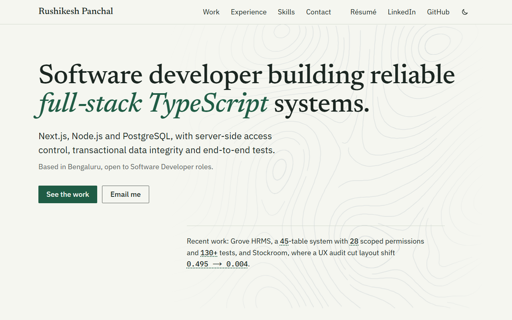
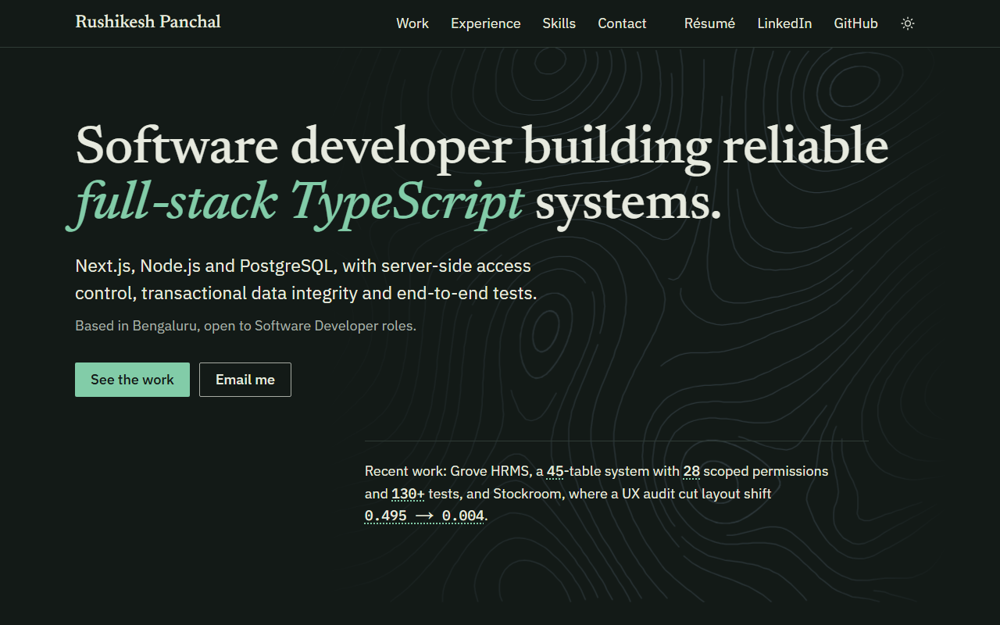
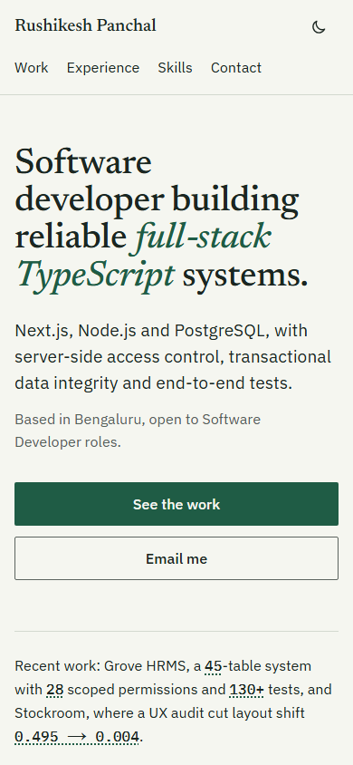
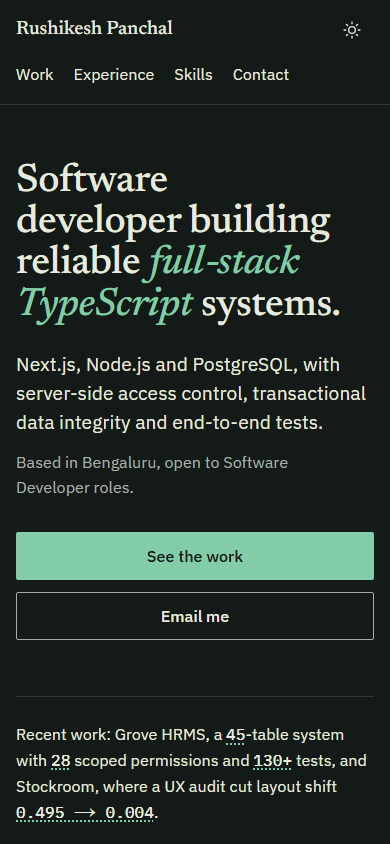
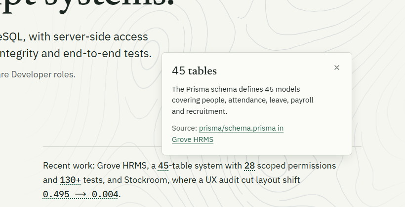
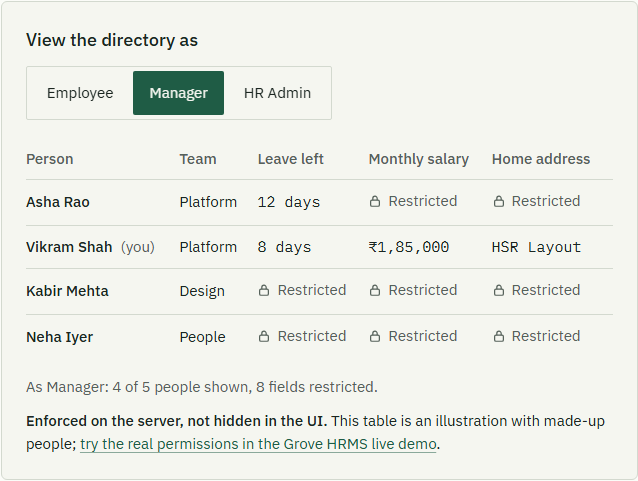
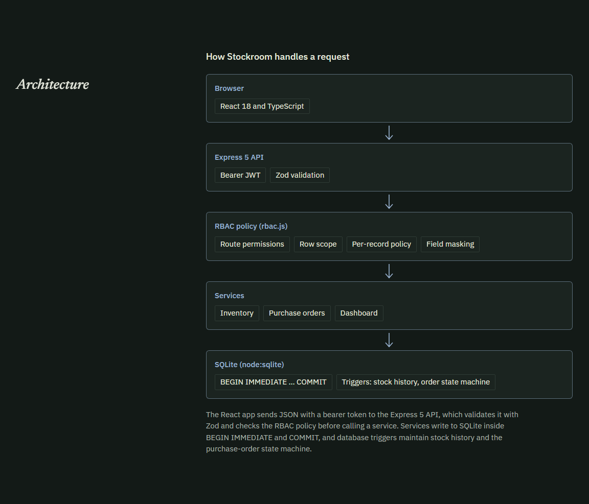
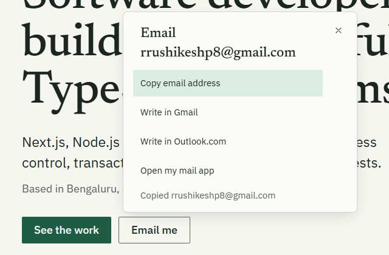
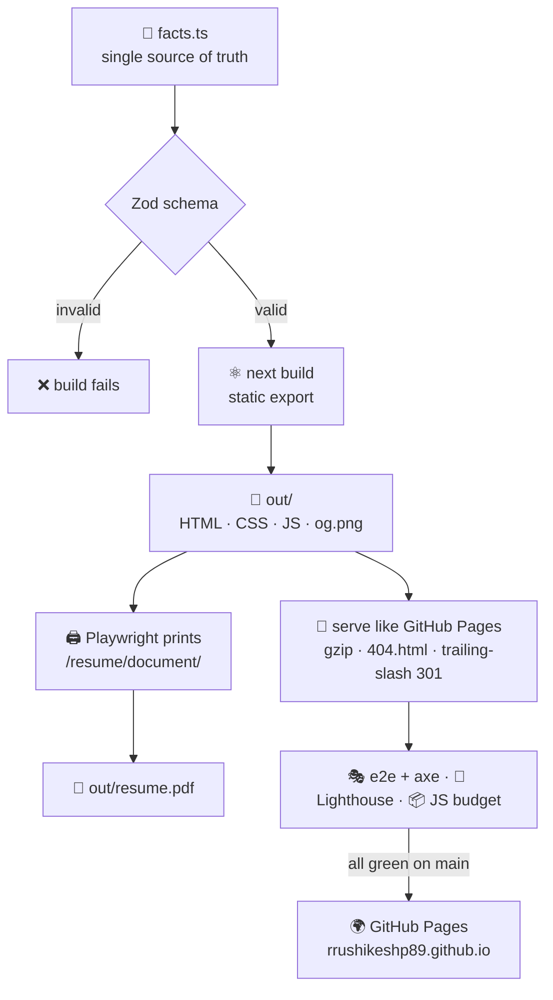
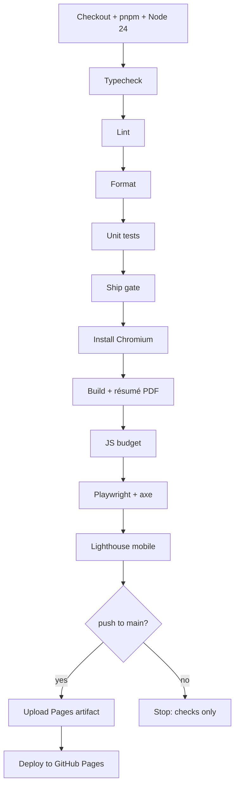

<!-- Banner -->
<p align="center">
  
</p>

<p align="center">
  <a href="https://rrushikeshp89.github.io">
    
  </a>
</p>

<p align="center">
  <a href="https://rrushikeshp89.github.io"></a>
  <a href="https://rrushikeshp89.github.io/resume.pdf"></a>
  <a href="https://www.linkedin.com/in/rushikesh-panchal/"></a>
</p>

<p align="center">
  <a href="https://github.com/rrushikeshp89/rrushikeshp89.github.io/actions/workflows/ci.yml"></a>
  
  
  
  
  
  
</p>

<p align="center">
  <a href="#-what-it-is">What it is</a> ·
  <a href="#-a-look-around">A look around</a> ·
  <a href="#-signature-features">Features</a> ·
  <a href="#-quality-gates">Quality</a> ·
  <a href="#-tech-stack">Stack</a> ·
  <a href="#-how-it-works">How it works</a> ·
  <a href="#-run-it-locally">Run it</a> ·
  <a href="#-decisions">Decisions</a>
</p>

---

## 🌿 What it is

**Rushikesh Panchal**, a Bengaluru-based Software Developer (B.Tech CSE, Data Science, Garden City University, 2026) who builds full-stack TypeScript business systems with **server-side access control**, **transactional data integrity** and **end-to-end testing**.

It has one job: convince a hiring manager in 30 seconds that the work is real, and make it easy to get in touch. So the site is built to be **evidence of the claims it makes**:

> **Show the why. Enforce it on the server. Prove it, then say what's missing.**

- Every number on the page is a **receipt**: click it and it tells you where it comes from, with a link to the exact file in the project's repository.
- Every project says **what it doesn't do yet**, taken from its own README.
- The site itself is strictly typed, Zod-validated, axe-clean in both themes, and tested **as it ships** on GitHub Pages.

<table>
  <tr>
    <td align="center"><b>🏢 Grove HRMS</b><br/><sub>45 tables · 28 scoped permissions · 130+ tests</sub><br/><a href="https://rrushikeshp89.github.io/work/grove-hrms/">Case study</a> · <a href="https://github.com/rrushikeshp89/grove-hrms">Source</a> · <a href="https://hrms.fluentopsai.com">Live</a></td>
    <td align="center"><b>📈 LeadHub CRM</b><br/><sub>Shared domain layer · Express 5 · Turso</sub><br/><a href="https://rrushikeshp89.github.io/work/leadhub-crm/">Case study</a> · <a href="https://github.com/rrushikeshp89/leadhub-crm">Source</a> · <a href="https://crm.fluentopsai.com/inquiry">Live</a></td>
    <td align="center"><b>📦 Stockroom ERP</b><br/><sub>Atomic receiving · CLS 0.495 → 0.004</sub><br/><a href="https://rrushikeshp89.github.io/work/stockroom-erp/">Case study</a> · <a href="https://github.com/rrushikeshp89/stockroom-erp">Source</a> · <a href="https://erp.fluentopsai.com">Live</a></td>
  </tr>
</table>

## 👀 A look around

<table>
  <tr>
    <td width="50%"></td>
    <td width="50%"></td>
  </tr>
  <tr>
    <td align="center"><sub><b>Light</b>: warm paper, deep ink, one confident green</sub></td>
    <td align="center"><sub><b>Dark</b>: tuned, not inverted; follows the system, remembers your choice</sub></td>
  </tr>
</table>

<p align="center">
  
  &nbsp;&nbsp;
  
  <br/><sub>Mobile-first: full-width thumb-reach CTAs, 44 px minimum targets, no sideways scrolling at 320 px</sub>
</p>

## ✨ Signature features

### 🧾 Show the receipts



Twelve numbers across the site (the hero sentence, the project numerals, the 15% Zetpeak result) are buttons. Activate one (click, <kbd>Enter</kbd> or <kbd>Space</kbd>, never hover) and a slip explains it and links to the proof: `prisma/schema.prisma` for the 45 tables, `src/lib/rbac.ts` for the 28 permissions, the UX report for 0.495 → 0.004.

- Native modal `<dialog>`: focus is trapped, <kbd>Esc</kbd> closes it, focus comes back.
- Anchored next to its number where CSS anchor positioning exists, centred on phones.
- Numerals count up once on first view, never under reduced motion, with zero layout shift.

<br clear="right"/>

### 🔐 Switch roles (Grove HRMS)



A miniature of Grove's permission model. Pick **Employee**, **Manager** or **HR Admin**, and a sample directory shows only what that role may see. Restricted cells say so with a lock icon, offboarded people appear for HR only, and a status line announces each change to screen readers.

The rules are a pure, unit-tested function (own / team / company scopes). The data is clearly labelled as made up, and the panel links to the real live demo. _Enforced on the server, not hidden in the UI._

<br clear="right"/>

### 🏗️ Case studies that show their working



Each project gets its own page: **problem → architecture → key decisions → proof → limitations**. The architecture is drawn as semantic HTML layers (it reflows at 320 px and at 200% zoom, where SVG text can't). Every claim links to a verified file, and the limitations come straight from each repository's README.

<br clear="right"/>

### 📮 Email that always works



A bare `mailto:` link does nothing on a machine without a mail app. Here **Email me** opens a panel: **Copy email address** (with a confirmation), **Write in Gmail**, **Write in Outlook.com** or **Open my mail app**. It's still a real `mailto:` link without JavaScript, and nothing is sent to any third party unless the visitor picks one.

<br clear="right"/>

### 📄 A résumé that can't drift

[`/resume.pdf`](https://rrushikeshp89.github.io/resume.pdf) is **generated from the same `facts.ts` as the site** on every build: Playwright prints a dedicated résumé page to A4. The build fails if it ever contains a phone number or spills past one page.

### 🌊 Real fluid dynamics, zero JavaScript

The faint contour lines behind the hero are streamlines traced through a 2D Navier-Stokes simulation run with [fluidsim](https://fluidsim.readthedocs.io) (`tools/flow-lines/generate.py`). Only a 4.4 kB SVG ships, as a CSS mask over the theme colour, and it's off on phones and under reduced motion.

## ✅ Quality gates

Every push runs the full pipeline. Only a green `main` is published.

| Gate                     | Target                                                             | Latest CI result                                    |
| :----------------------- | :----------------------------------------------------------------- | :-------------------------------------------------- |
| 🟦 TypeScript            | `strict`, `noUncheckedIndexedAccess`, `exactOptionalPropertyTypes` | ✅ passes                                           |
| 🧹 ESLint                | Next + **jsx-a11y strict**, no `any`, no `!`                       | ✅ 0 problems                                       |
| 🧪 Vitest                | Schema, facts, contrast, role rules, routes                        | ✅ **47** passing                                   |
| 🎭 Playwright + axe      | Every route × light/dark × 1280/375 px                             | ✅ **172** passing, **0** axe violations            |
| 🔦 Lighthouse (mobile)   | Perf ≥ 95 · A11y 100 · BP ≥ 95 · SEO 100                           | ✅ **99 · 100 · 100 · 100** on `/` and a case study |
| ⚡ Core Web Vitals (lab) | LCP < 2.0 s · CLS < 0.02                                           | ✅ LCP **0.91 s** · CLS **0.000**                   |
| 📦 JS budget             | < 150 kB gzipped on `/`                                            | ✅ **140.1 kB**                                     |
| 🚢 Ship gate             | No `TODO(confirm)` left in `facts.ts`                              | ✅ passes                                           |

<details>
<summary><b>What the end-to-end suite checks</b></summary>
<br/>

- **Accessibility:** axe on every route (home, design system, three case studies, résumé, 404) in both themes at desktop and phone width; plus open receipts and the open email panel.
- **Keyboard:** skip link (including after client-side navigation), receipts open with <kbd>Enter</kbd>/<kbd>Space</kbd> and return focus, role switch with arrow keys, theme toggle.
- **Content integrity:** every number shown on the page must exist in `facts.ts` (or the labelled demo data); no `TODO(confirm)`, no phone number, no `tel:` link anywhere.
- **Layout:** no sideways scroll, 44 px minimum targets, count-up causes less than 0.01 layout shift.
- **Hosting:** the meta CSP is present and blocks a foreign script; real 404s; `og.png` served as `image/png`; sitemap and robots; `/resume/` forwards to the PDF.

</details>

## 🧰 Tech stack

<p align="center">
  
  
  
  
  
  <br/>
  
  
  
  
  <br/>
  
  
  
  
</p>

| Layer         | Choice                                            | Why                                                            |
| :------------ | :------------------------------------------------ | :------------------------------------------------------------- |
| Framework     | Next.js App Router, **static export**             | Every route prerendered; no server to run or secure            |
| Content       | One typed `facts.ts`, parsed by **Zod** at build  | An invalid fact fails `next build`; types come from the schema |
| Styling       | Tailwind v4 over CSS-variable tokens              | Light and dark palettes, contrast-tested in unit tests         |
| Interactivity | Native `<dialog>`, radios, CSS anchor positioning | Accessible by default; no UI component library                 |
| Type          | Newsreader, IBM Plex Sans, IBM Plex Mono          | Self-hosted with `next/font`; 88 kB total                      |
| Hosting       | GitHub Pages via Actions                          | Deploys only after every gate passes                           |

## 🧭 How it works



<details>
<summary><b>The CI pipeline, step by step</b></summary>
<br/>



</details>

<details>
<summary><b>Hosting notes (what GitHub Pages can and can't do)</b></summary>
<br/>

GitHub Pages serves files only, so:

- The **Content-Security-Policy** ships as a `<meta http-equiv>` tag (`src/lib/csp.ts`). A meta policy can't carry `frame-ancestors`, so anti-framing isn't available on this host. HTTPS and HSTS are enforced by github.io.
- **`/resume/`** forwards with a meta refresh instead of a server redirect.
- **Share images** are real `og.png` route files, so they're served as `image/png`.
- Tests run against `scripts/serve-static.mjs`, which behaves like Pages: gzip, `index.html` resolution, a 301 to add the trailing slash, and `404.html` with status 404.

</details>

## 🗂️ Project structure

```text
src/
├── app/                      routes: home, /work/<slug>/, /resume/, /resume/document/, /design/, 404
│   ├── og.png/               share image (and one per case study)
│   ├── sitemap.ts, robots.ts
│   └── layout.tsx            fonts, meta CSP, theme script, header and footer
├── components/
│   ├── sections/             Hero, SelectedWork, Approach, Experience, StackGrid, Credentials, Contact
│   ├── receipts/             Receipt (native dialog) and CountUp
│   ├── project/              ProjectCard, MetricList, RoleSwitch, ArchitectureDiagram
│   ├── case-study/           the shared case-study page
│   ├── contact/              EmailOptions panel
│   └── ui/                   Button, TextLink, Chip, Card, Section, SkipLink
├── content/                  facts.ts · schema.ts · queries.ts · roleDemo.ts
├── lib/                      csp, og-image, permissions-demo, format, theme
└── styles/tokens.css         light, dark and print palettes
scripts/                      serve-static · build-resume · lighthouse · check-bundle
tests/unit · tests/e2e        Vitest and Playwright specs
tools/flow-lines/             fluidsim generator for the hero art (offline)
DECISIONS.md                  32 architecture decision records, skills log, measurements
```

## 🚀 Run it locally

> Requires **Node 22+** (24 LTS in `.nvmrc`) and **pnpm**.

```bash
pnpm install
pnpm dev          # http://localhost:3000, development
```

```bash
pnpm build        # static export to out/, then prints out/resume.pdf
pnpm start        # serves out/ exactly like GitHub Pages
```

| Command             | What it does                                             |
| :------------------ | :------------------------------------------------------- |
| `pnpm typecheck`    | `next typegen` + `tsc` in strict mode                    |
| `pnpm lint`         | ESLint with jsx-a11y strict                              |
| `pnpm format:check` | Prettier, with Tailwind class sorting                    |
| `pnpm test`         | Vitest unit tests                                        |
| `pnpm test:e2e`     | Playwright + axe against `out/` (run `pnpm build` first) |
| `pnpm check:bundle` | Gzipped JS per route; fails if `/` passes 150 kB         |
| `pnpm lhci`         | Lighthouse, mobile, median of 5, on `/` and a case study |
| `pnpm test:ship`    | Release gate: fails if any `TODO(confirm)` remains       |
| `pnpm check`        | typecheck + lint + unit tests + build                    |

### ✏️ Changing what the site says

Everything visible (copy, numbers, links, case studies, the résumé) lives in **`src/content/facts.ts`**. Edit it, run `pnpm build`, and the site, share images and résumé PDF all update together. A Zod schema rejects bad input (non-HTTPS links, malformed dates, more than three bullets on a project, duplicate IDs), and a test refuses any phone number.

## 🎨 Design system

<p>
  
  
  
  
  
  
  <sub>&nbsp;light</sub>
  <br/>
  
  
  
  
  
  
  <sub>&nbsp;dark</sub>
</p>

- **Concept: marginalia.** Section titles sit in a narrow left margin in Newsreader italic, like notes in an engineering notebook; content runs alongside.
- **Type:** Newsreader 500 for display, IBM Plex Sans for text, IBM Plex Mono only for figures. Fluid `clamp()` scale, body never below 16 px.
- **Contrast:** 28 colour pairs (14 per theme) are asserted at WCAG AA in `tests/unit/tokens.test.ts`.
- **Motion:** one count-up and the slip entrance; everything respects `prefers-reduced-motion`.

A living style guide is at [`/design/`](https://rrushikeshp89.github.io/design/) (not indexed).

## 📚 Decisions

[`DECISIONS.md`](DECISIONS.md) records **32 ADRs**, including the ones that changed the plan:

| ADR | Decision                                                                     |
| :-- | :--------------------------------------------------------------------------- |
| 017 | Static font cuts after the optical-size variable font cost 279 kB            |
| 018 | Hero art from a real fluid simulation, shipped as a 4.4 kB CSS mask          |
| 020 | Native `<dialog>` instead of Radix Popover to stay under the JS budget       |
| 023 | One static route per case study, so unknown URLs are true 404s               |
| 024 | Architecture diagrams as HTML, because SVG text can't reflow                 |
| 029 | GitHub Pages: static export, meta CSP, Pages-faithful testing                |
| 030 | The résumé PDF is generated from `facts.ts` and can't drift                  |
| 031 | "Email me" opens an options panel, because `mailto:` alone can fail silently |

It also holds the skills log, the reader personas, and every Lighthouse and bundle measurement, phase by phase.

## 🙏 Credits

- Fonts: [Newsreader](https://github.com/productiontype/Newsreader) and [IBM Plex](https://github.com/IBM/plex), both under the SIL Open Font License; served through `next/font` and [Fontsource](https://fontsource.org).
- Hero streamlines simulated with [fluidsim](https://foss.heptapod.net/fluiddyn/fluidsim).
- README banner by [capsule-render](https://github.com/kyechan99/capsule-render), animated tagline by [readme-typing-svg](https://github.com/DenverCoder1/readme-typing-svg), badges by [shields.io](https://shields.io).

The source is public for review. There is no license file, so default copyright applies.

## 📬 Contact

<p align="center">
  <a href="mailto:rrushikeshp8@gmail.com"></a>
  <a href="https://www.linkedin.com/in/rushikesh-panchal/"></a>
  <a href="https://github.com/rrushikeshp89"></a>
</p>

<p align="center"><i>Based in Bengaluru, open to Software Developer roles.</i></p>

<p align="center">
  
</p>
